# Praktikum 6: Java Script DOM Event

Repository ini disusun untuk memenuhi tugas **Praktikum 6 - Java Script DOM Event Handling** pada mata kuliah Pemrograman Web.

**Identitas Mahasiswa:**
- **Nama:** Gama Daya Laksana
- **NIM:** 312510051
- **Kelas:** I253A
- **Program Studi:** Teknik Informatika
- **Dosen Pengampu:** Agung Nugroho, S.Kom., M.Kom.
- **Kampus:** Universitas Pelita Bangsa

---

## Struktur Direktori Proyek

```text
Lab6Web/
├── screenshots/
│   ├── 1.png               
│   ├── 2.png               
│   ├── 3.png               
│   ├── 4.png              
│   ├── 5.png              
│   └── 6.png
│   └── 7.png
│   └── 8.png
│   └── 9.png               
│   └── 10.png
│   └── 11.png 
├── README.md
├── lab6_dom_event/
│   ├── index.html         
│   └── style.css
│   └── script.js      
```

# Langkah-Langkah Praktikum

## Latihan 1 — Mengubah teks dengan DOM
Pilih elemen HTML berdasarkan id dan ubah kontennya.

**JavaScript**
```js
const judul = document.getElementById("judul");
const pesan = document.getElementById("pesan");
judul.textContent = "Belajar JavaScript DOM";
pesan.textContent = "Konten berhasil diubah oleh JavaScript.";
```

• Jalankan index.html di browser.
• Pastikan judul dan paragraf berubah.
• Ubah pesan menjadi kalimat lain dan amati hasilnya.

**Screenshot Hasil:**

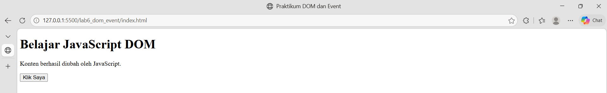

## Latihan 2 — Event click
Saat tombol diklik, ubah teks paragraf dan tampilkan waktu saat tindakan dilakukan.

**JavaScript**
```js
const tombol = document.getElementById("tombolAksi");
const pesan = document.getElementById("pesan");
tombol.addEventListener("click", function () {
pesan.textContent = "Tombol diklik pada " + new Date().toLocaleTimeString();
});
```

Uji dengan menekan tombol beberapa kali dan pastikan pesan diperbarui.

**Screenshot Hasil:**

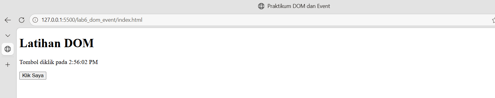

## Latihan 3 — Mengubah kelas dan gaya CSS
Tambahkan aturan CSS berikut ke style.css dan buat paragraf id teksGaya serta tombol id tombolGaya.

**CSS**
```css
.highlight {
color: #173f75;
background-color: #e6f1ff;
border-left: 4px solid #3478c8;
padding: 12px;
}
.teks-besar { font-size: 1.4rem; }
```

**JavaScript**
```js
const tombolGaya = document.getElementById("tombolGaya");
const teksGaya = document.getElementById("teksGaya");
tombolGaya.addEventListener("click", function () {
teksGaya.classList.toggle("highlight");
teksGaya.classList.toggle("teks-besar");
});
```

Amati perbedaan classList.add(), classList.remove(), dan classList.toggle().

**Screenshot Hasil:**

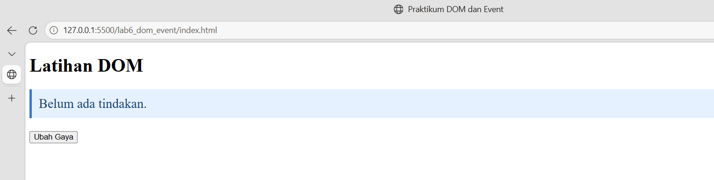


## Latihan 4 — Event input dan penghitung karakter
Buat input teks dan indikator jumlah karakter yang diperbarui saat pengguna mengetik.

**HTML**
```html
<label for="namaInput">Nama:</label>
    <input type="text" id="namaInput" maxlength="40">
    <p>Jumlah karakter: <span id="jumlahKarakter">0</span></p>
```

**JavaScript**
```js
const namaInput = document.getElementById("namaInput");
const jumlahKarakter = document.getElementById("jumlahKarakter");
namaInput.addEventListener("input", function () {
    jumlahKarakter.textContent = namaInput.value.length;
});
```

Uji dengan mengetik, menghapus, dan menempelkan teks.

**Screenshot Hasil:**

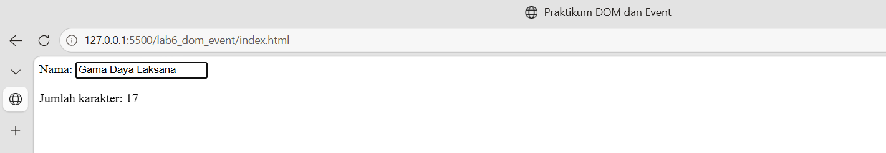


## Latihan 5 — Validasi form pendaftaran
Buat form nama, email, dan usia. Program menampilkan pesan jika input tidak sesuai.

**HTML**
```html
    <form id="formPendaftaran" novalidate>
        <label for="nama">Nama lengkap</label>
        <input id="nama" name="nama" type="text">
        <label for="email">Email</label>
        <input id="email" name="email" type="email">
        <label for="usia">Usia</label>
        <input id="usia" name="usia" type="number" min="17" max="100">
        <button type="submit">Daftar</button>
    </form>
    <p id="pesanForm" aria-live="polite"></p>
```

**JavaScript**
```js
const form = document.getElementById("formPendaftaran");
const pesanForm = document.getElementById("pesanForm");
form.addEventListener("submit", function (event) {
    event.preventDefault();
    const nama = document.getElementById("nama").value.trim();
    const email = document.getElementById("email").value.trim();
    const usiaInput = document.getElementById("usia").value;
    const usia = Number(usiaInput);
    const polaEmail = /^[^\s@]+@[^\s@]+\.[^\s@]+$/;
    if (nama === "") {
        pesanForm.textContent = "Nama wajib diisi.";
    } else if (!polaEmail.test(email)) {
        pesanForm.textContent = "Masukkan email yang valid.";
    } else if (usiaInput === "" || !Number.isInteger(usia) || usia < 17 || usia > 100) {
        pesanForm.textContent = "Usia harus berupa bilangan bulat 17–100.";
    } else {
        pesanForm.textContent = "Validasi berhasil. Form siap diproses.";
        form.reset();
    }
});
```
Uji minimal lima kondisi: semua kosong, nama kosong, email tidak valid, usia di bawah 17, dan semua input
valid.

**Screenshot Hasil:**

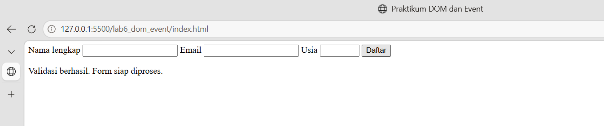
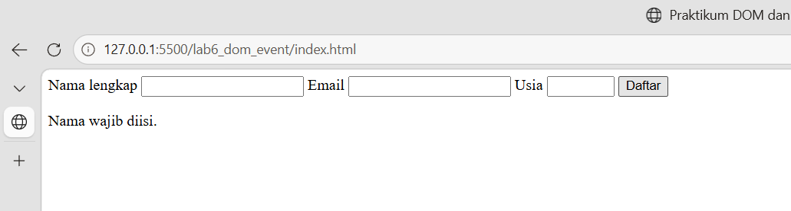
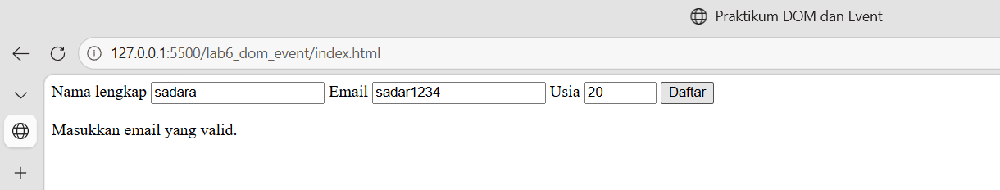
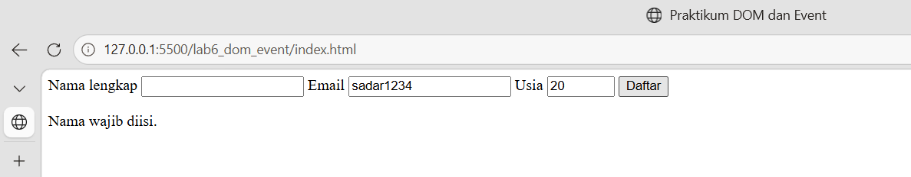

## Latihan 6 — Daftar tugas sederhana (To-do List)
Buat aplikasi kecil untuk menambahkan tugas dan menandai tugas selesai.

**HTML**
```html
    <section>
        <h2>Daftar Tugas</h2>
        <label for="inputTugas">Tugas baru</label>
        <input id="inputTugas" type="text">
        <button id="tambahTugas" type="button">Tambah</button>
        <p id="pesanTugas" aria-live="polite"></p>
        <ul id="daftarTugas"></ul>
    </section>
```

**JavaScript**
```js
const inputTugas = document.getElementById("inputTugas");
const tambahTugas = document.getElementById("tambahTugas");
const daftarTugas = document.getElementById("daftarTugas");
const pesanTugas = document.getElementById("pesanTugas");

tambahTugas.addEventListener("click", function () {
    const teks = inputTugas.value.trim();
    if (teks === "") {
        pesanTugas.textContent = "Tulis tugas terlebih dahulu.";
        return;
    }
    const item = document.createElement("li");
    const label = document.createElement("span");
    const selesai = document.createElement("button");
    label.textContent = teks + " ";
    selesai.type = "button";
    selesai.textContent = "Tandai selesai";
    selesai.addEventListener("click", function () {
        item.classList.toggle("selesai");
        selesai.textContent = item.classList.contains("selesai")
            ? "Batalkan selesai" : "Tandai selesai";
    });
    item.append(label, selesai);
    daftarTugas.appendChild(item);
    inputTugas.value = "";
    pesanTugas.textContent = "Tugas ditambahkan.";
    inputTugas.focus();
});
```

**CSS**
```css
.selesai span {
  text-decoration: line-through;
  color: #687386;
}
li {
  margin-bottom: 8px;
}
```

Contoh menggunakan textContent untuk menampilkan teks pengguna sebagai teks, bukan markup HTML.

**Screenshot Hasil:**
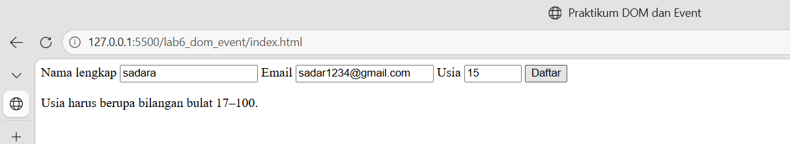

## F. Mini Project — Form Pendaftaran Workshop

Kembangkan halaman pendaftaran workshop dengan minimal tiga fungsi interaktif.
• Validasi nama, email, dan pilihan sesi.
• Penghitung karakter atau ringkasan input secara langsung.
• Pesan kesalahan dan pesan sukses yang tampil pada halaman.
• Tombol reset atau hapus input.
• Gunakan addEventListener() untuk event input, change, click, atau submit.

Pisahkan kode ke index.html, style.css, dan script.js. Buat antarmuka yang mudah digunakan di desktop
maupun perangkat mobile.

**HTML**
```Html

<!DOCTYPE html>
<html lang="id">
<head>
    <meta charset="UTF-8">
    <meta name="viewport" content="width=device-width, initial-scale=1.0">
    <title>Pendaftaran Workshop</title>
    <link rel="stylesheet" href="style.css">
    <script src="script.js" defer></script>
</head>
<body>
    <main class="container">
        <header class="hero">
            <span class="tag">MINI PROJECT</span>
            <h1>Daftar Workshop</h1>
            <p>Tambah pengetahuan dan kembangkan keterampilanmu
                melalui workshop interaktif.</p>
        </header>

        <section class="card">
            <h2>Formulir Pendaftaran</h2>
            <p class="subtitle">Lengkapi data diri kamu di bawah ini.</p>

            <form id="workshopForm" novalidate>
                <div class="form-group">
                    <label for="nama">Nama Lengkap</label>
                    <input type="text" id="nama"
                        placeholder="Masukkan nama lengkap"
                        autocomplete="name">
                    <small id="namaError" class="error"></small>
                    <small class="counter">
                        <span id="charCount">0</span>/60 karakter
                    </small>
                </div>

                <div class="form-group">
                    <label for="email">Alamat Email</label>
                    <input type="email" id="email"
                        placeholder="nama@email.com"
                        autocomplete="email">
                    <small id="emailError" class="error"></small>
                </div>

                <div class="form-group">
                    <label for="sesi">Pilih Sesi Workshop</label>
                    <select id="sesi">
                        <option value="">-- Pilih sesi --</option>
                        <option value="HTML & CSS">
                            HTML & CSS - 09.00 WIB
                        </option>
                        <option value="JavaScript">
                            JavaScript - 13.00 WIB
                        </option>
                        <option value="Python Dasar">
                            Python Dasar - 15.00 WIB
                        </option>
                    </select>
                    <small id="sesiError" class="error"></small>
                </div>

                <div class="form-group">
                    <label for="catatan">Catatan (opsional)</label>
                    <textarea id="catatan" rows="3" maxlength="200"
                        placeholder="Tuliskan harapan kamu mengikuti workshop..."></textarea>
                    <small class="counter">
                        <span id="catatanCount">0</span>/200 karakter
                    </small>
                </div>

                <div id="message" class="message"
                    role="status" aria-live="polite"></div>

                <div class="button-group">
                    <button type="submit" class="btn-primary">
                        Daftar Sekarang
                    </button>
                    <button type="button" id="resetBtn"
                        class="btn-secondary">
                        Reset
                    </button>
                </div>
            </form>
        </section>

        <section class="card summary">
            <h2>Ringkasan Pendaftaran</h2>
            <p class="subtitle">Informasi diperbarui secara langsung.</p>

            <div class="summary-item">
                <span>Nama</span>
                <strong id="previewNama">Belum diisi</strong>
            </div>
            <div class="summary-item">
                <span>Email</span>
                <strong id="previewEmail">Belum diisi</strong>
            </div>
            <div class="summary-item">
                <span>Sesi</span>
                <strong id="previewSesi">Belum dipilih</strong>
            </div>
            <div class="summary-item">
                <span>Catatan</span>
                <strong id="previewCatatan">Tidak ada</strong>
            </div>
        </section>

        <footer>
            <p>Mini Project Form Pendaftaran Workshop</p>
        </footer>
    </main>
</body>
</html>

```
**CSS**
```CSS

* {
    box-sizing: border-box;
    margin: 0;
    padding: 0;
}

body {
    font-family: Arial, Helvetica, sans-serif;
    background: #f3f6fc;
    color: #1e293b;
    line-height: 1.6;
}

.container {
    width: min(100% - 32px, 720px);
    margin: 40px auto;
}

.hero {
    text-align: center;
    margin-bottom: 28px;
}

.tag {
    display: inline-block;
    padding: 5px 12px;
    background: #dbeafe;
    color: #1d4ed8;
    border-radius: 20px;
    font-size: 12px;
    font-weight: bold;
    letter-spacing: 1px;
}

.hero h1 {
    margin: 12px 0 8px;
    font-size: clamp(28px, 5vw, 38px);
}

.hero p,
.subtitle {
    color: #64748b;
}

.card {
    background: #ffffff;
    padding: 28px;
    margin-bottom: 22px;
    border: 1px solid #e2e8f0;
    border-radius: 16px;
    box-shadow: 0 8px 24px rgba(15, 23, 42, 0.05);
}

.card h2 {
    font-size: 21px;
    margin-bottom: 4px;
}

.subtitle {
    font-size: 14px;
    margin-bottom: 24px;
}

.form-group {
    margin-bottom: 20px;
}

label {
    display: block;
    font-weight: 600;
    font-size: 14px;
    margin-bottom: 7px;
}

input,
select,
textarea {
    width: 100%;
    padding: 12px 14px;
    border: 1px solid #cbd5e1;
    border-radius: 9px;
    font: inherit;
    font-size: 14px;
    background: #fff;
    color: #1e293b;
    outline: none;
    transition: border-color 0.2s, box-shadow 0.2s;
}

input:focus,
select:focus,
textarea:focus {
    border-color: #2563eb;
    box-shadow: 0 0 0 3px #dbeafe;
}

textarea {
    resize: vertical;
}

.counter {
    display: block;
    text-align: right;
    color: #64748b;
    font-size: 12px;
    margin-top: 4px;
}

.error {
    display: block;
    color: #dc2626;
    font-size: 12px;
    margin-top: 4px;
}

.invalid {
    border-color: #dc2626;
}

.message {
    display: none;
    padding: 12px;
    border-radius: 9px;
    font-size: 14px;
    margin-bottom: 16px;
}

.message.success {
    display: block;
    color: #166534;
    background: #dcfce7;
}

.message.failure {
    display: block;
    color: #991b1b;
    background: #fee2e2;
}

.button-group {
    display: flex;
    gap: 12px;
    margin-top: 24px;
}

button {
    flex: 1;
    padding: 13px 16px;
    border: none;
    border-radius: 9px;
    font-size: 14px;
    font-weight: bold;
    cursor: pointer;
    transition: background 0.2s, transform 0.2s;
}

button:hover {
    transform: translateY(-1px);
}

.btn-primary {
    background: #2563eb;
    color: white;
}

.btn-primary:hover {
    background: #1d4ed8;
}

.btn-secondary {
    background: #e2e8f0;
    color: #334155;
}

.btn-secondary:hover {
    background: #cbd5e1;
}

.summary-item {
    display: flex;
    justify-content: space-between;
    gap: 16px;
    padding: 12px 0;
    border-bottom: 1px solid #e2e8f0;
}

.summary-item:last-child {
    border-bottom: none;
}

.summary-item span {
    color: #64748b;
    flex-shrink: 0;
}

.summary-item strong {
    text-align: right;
    overflow-wrap: anywhere;
}

footer {
    text-align: center;
    color: #94a3b8;
    font-size: 12px;
    padding: 10px;
}

@media (max-width: 480px) {
    .container {
        width: min(100% - 20px, 720px);
        margin: 20px auto;
    }

    .card {
        padding: 20px 16px;
        border-radius: 12px;
    }

    .button-group {
        flex-direction: column;
    }

    .summary-item {
        gap: 10px;
        font-size: 13px;
    }
}

```

**JavaScript**
```JS

const form = document.getElementById("workshopForm");

const nama = document.getElementById("nama");
const email = document.getElementById("email");
const sesi = document.getElementById("sesi");
const catatan = document.getElementById("catatan");

const message = document.getElementById("message");
const resetBtn = document.getElementById("resetBtn");

// Menghitung karakter nama dan catatan
function updateCounter() {
    document.getElementById("charCount").textContent =
        nama.value.length;

    document.getElementById("catatanCount").textContent =
        catatan.value.length;
}

// Memperbarui ringkasan secara langsung
function updatePreview() {
    document.getElementById("previewNama").textContent =
        nama.value.trim() || "Belum diisi";

    document.getElementById("previewEmail").textContent =
        email.value.trim() || "Belum diisi";

    document.getElementById("previewSesi").textContent =
        sesi.value || "Belum dipilih";

    document.getElementById("previewCatatan").textContent =
        catatan.value.trim() || "Tidak ada";
}

// Menampilkan atau menghapus pesan kesalahan
function showError(field, errorId, text) {
    document.getElementById(errorId).textContent = text;
    field.classList.toggle("invalid", Boolean(text));
    field.setAttribute("aria-invalid", Boolean(text));
}

// Validasi seluruh input
function validateForm() {
    let valid = true;

    const namaValue = nama.value.trim();
    const emailValue = email.value.trim();
    const emailPattern = /^[^\s@]+@[^\s@]+\.[^\s@]+$/;

    let namaError = "";
    let emailError = "";
    let sesiError = "";

    if (namaValue.length < 3) {
        namaError = "Nama minimal 3 karakter.";
    } else if (namaValue.length > 60) {
        namaError = "Nama maksimal 60 karakter.";
    }

    if (!emailValue) {
        emailError = "Email wajib diisi.";
    } else if (!emailPattern.test(emailValue)) {
        emailError = "Format email tidak valid.";
    }

    if (!sesi.value) {
        sesiError = "Silakan pilih sesi workshop.";
    }

    showError(nama, "namaError", namaError);
    showError(email, "emailError", emailError);
    showError(sesi, "sesiError", sesiError);

    if (namaError || emailError || sesiError) {
        valid = false;
    }

    return valid;
}

// Event input: memperbarui hitungan dan ringkasan
[nama, email, catatan].forEach(function (field) {
    field.addEventListener("input", function () {
        updateCounter();
        updatePreview();

        // Hapus pesan lama ketika pengguna mengedit data
        message.textContent = "";
        message.className = "message";

        // Validasi ulang jika sebelumnya sudah ada kesalahan
        if (field === nama &&
            document.getElementById("namaError").textContent) {
            showError(
                nama,
                "namaError",
                nama.value.trim().length < 3
                    ? "Nama minimal 3 karakter."
                    : nama.value.trim().length > 60
                    ? "Nama maksimal 60 karakter."
                    : ""
            );
        }

        if (field === email &&
            document.getElementById("emailError").textContent) {
            const pattern = /^[^\s@]+@[^\s@]+\.[^\s@]+$/;
            showError(
                email,
                "emailError",
                !email.value.trim()
                    ? "Email wajib diisi."
                    : !pattern.test(email.value.trim())
                    ? "Format email tidak valid."
                    : ""
            );
        }
    });
});

// Event change: saat sesi berubah
sesi.addEventListener("change", function () {
    updatePreview();
    message.textContent = "";
    message.className = "message";

    if (document.getElementById("sesiError").textContent) {
        showError(
            sesi,
            "sesiError",
            sesi.value ? "" : "Silakan pilih sesi workshop."
        );
    }
});

// Event submit: validasi dan pesan hasil
form.addEventListener("submit", function (event) {
    event.preventDefault();

    if (validateForm()) {
        message.textContent =
            "Pendaftaran berhasil! Data kamu telah divalidasi.";
        message.className = "message success";
    } else {
        message.textContent =
            "Pendaftaran gagal. Periksa kembali data kamu.";
        message.className = "message failure";

        const firstInvalid = form.querySelector(".invalid");
        if (firstInvalid) {
            firstInvalid.focus();
        }
    }
});

// Event click: reset seluruh form
resetBtn.addEventListener("click", function () {
    form.reset();

    ["namaError", "emailError", "sesiError"].forEach(function (id) {
        document.getElementById(id).textContent = "";
    });

    [nama, email, sesi].forEach(function (field) {
        field.classList.remove("invalid");
        field.removeAttribute("aria-invalid");
    });

    message.textContent = "";
    message.className = "message";

    updateCounter();
    updatePreview();
});

// Inisialisasi tampilan
updateCounter();
updatePreview();

```

## G. Eksperimen Mandiri
1. Tambahkan tombol untuk menghapus satu item dari To-do List.

**JavaScript**
```js
const inputTugas = document.getElementById("inputTugas");
const tambahTugas = document.getElementById("tambahTugas");
const daftarTugas = document.getElementById("daftarTugas");
const pesanTugas = document.getElementById("pesanTugas");
const hapusTugas = document.getElementById("hapusTugas");

tambahTugas.addEventListener("click", function () {
    const teks = inputTugas.value.trim();
    if (teks === "") {
        pesanTugas.textContent = "Tulis tugas terlebih dahulu.";
        return;
    }
    const item = document.createElement("li");
    const label = document.createElement("span");
    const selesai = document.createElement("button");
    const hapus = document.createElement("button");

    hapus.type = "button";
    hapus.textContent = "Hapus";
    hapus.style.marginLeft = "4px";
    hapus.addEventListener("click", function () {
        item.remove();
        pesanTugas.textContent = "Tugas dihapus.";
    });

    label.textContent = teks + " ";
    selesai.type = "button";
    selesai.textContent = "Tandai selesai";
    selesai.addEventListener("click", function () {
        item.classList.toggle("selesai");
        selesai.textContent = item.classList.contains("selesai")
            ? "Batalkan selesai" : "Tandai selesai";
    });
    
    item.append(label, selesai, hapus);
    daftarTugas.appendChild(item);
    
    inputTugas.value = "";
    pesanTugas.textContent = "Tugas ditambahkan.";
    inputTugas.focus();
});
```

2. Ubah validasi agar nama minimal terdiri dari tiga karakter.

**JavaScript**
```js
const form = document.getElementById("formPendaftaran");
const pesanForm = document.getElementById("pesanForm");

form.addEventListener("submit", function (event) {
    event.preventDefault();
    const nama = document.getElementById("nama").value.trim();
    const email = document.getElementById("email").value.trim();
    const usiaInput = document.getElementById("usia").value;
    const usia = Number(usiaInput);
    const polaEmail = /^[^\s@]+@[^\s@]+\.[^\s@]+$/;
    if (nama.length < 3) {
        pesanForm.textContent = "Nama harus terdiri dari minimal 3 karakter.";
    } else if (!polaEmail.test(email)) {
        pesanForm.textContent = "Masukkan email yang valid.";
    } else if (usiaInput === "" || !Number.isInteger(usia) || usia < 17 || usia > 100) {
        pesanForm.textContent = "Usia harus berupa bilangan bulat 17–100.";
    } else {
        pesanForm.textContent = "Validasi berhasil. Form siap diproses.";
        form.reset();
    }
});
```
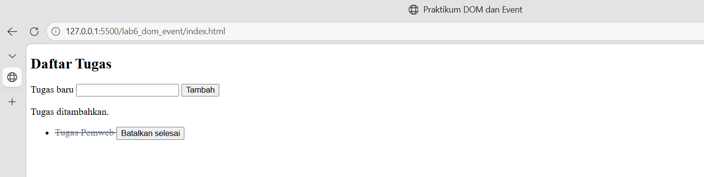
3. Tambahkan event change pada dropdown sesi workshop dan tampilkan sesi yang dipilih.
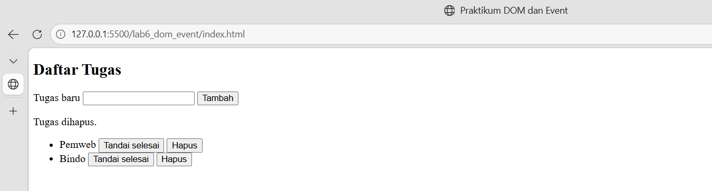

4. Buat tombol untuk menyembunyikan dan menampilkan paragraf menggunakan class CSS.

**HTML**
```html

<section class="card">
    <h2>Informasi Workshop</h2>

    <p id="infoWorkshop" class="paragraf-info">
        Workshop ini dirancang untuk membantu peserta
        mempelajari keterampilan teknologi dan pemrograman
        melalui materi yang praktis.
    </p>

    <button type="button" id="toggleBtn" class="btn-primary">
        Sembunyikan Informasi
    </button>
</section>

```

**JavaScript**
```js
toggleBtn.addEventListener("click", function () {
    infoWorkshop.classList.toggle("hidden");

    if (infoWorkshop.classList.contains("hidden")) {
        toggleBtn.textContent = "Tampilkan Informasi";
    } else {
        toggleBtn.textContent = "Sembunyikan Informasi";
    }
});
```
5. Coba pindahkan script tanpa defer ke bagian head. Amati kemungkinan masalah dan jelaskan

• Pemblokiran Rendering (Render-Blocking): Browser terpaksa berhenti memuat halaman HTML untuk mengunduh dan mengeksekusi script. Hal ini menyebabkan layar putih kosong (blank) muncul lebih lama bagi pengguna.
• Error Manipulasi DOM: Script JavaScript akan mengalami error (Cannot read properties of null) jika mencoba mengakses elemen HTML, karena script dieksekusi sebelum elemen-elemen HTML di dalam <body> selesai dibuat.

# H. Pertanyaan Evaluasi

## 1. Apa yang dimaksud dengan DOM dan apa manfaatnya?

DOM (*Document Object Model*) adalah representasi dokumen HTML dalam bentuk struktur objek yang dapat diakses dan dimanipulasi menggunakan JavaScript. DOM memungkinkan programmer untuk mengakses, mengubah, menambahkan, atau menghapus elemen HTML secara dinamis.

Manfaat DOM antara lain:
- Mengubah teks dan konten pada halaman web.
- Mengubah atribut dan style elemen HTML.
- Menambahkan atau menghapus elemen.
- Membuat halaman web menjadi interaktif melalui event seperti klik dan input.

## 2. Apa perbedaan `getElementById()`, `querySelector()`, dan `querySelectorAll()`?

Ketiga metode tersebut digunakan untuk memilih elemen HTML, tetapi memiliki perbedaan dalam cara pemilihan dan hasil yang dikembalikan.

- **`getElementById()`** digunakan untuk memilih satu elemen berdasarkan nilai atribut `id`.
- **`querySelector()`** digunakan untuk memilih elemen pertama yang cocok dengan selector CSS tertentu.
- **`querySelectorAll()`** digunakan untuk memilih semua elemen yang cocok dengan selector CSS tertentu dan mengembalikannya dalam bentuk `NodeList`.

Contoh penggunaan:

```javascript
const judul = document.getElementById("judul");
const paragraf = document.querySelector("p");
const semuaParagraf = document.querySelectorAll("p");
```

Dengan demikian, `getElementById()` berfokus pada ID, `querySelector()` mengambil satu elemen yang cocok, sedangkan `querySelectorAll()` mengambil seluruh elemen yang cocok.

## 3. Apa fungsi `addEventListener()` dan sebutkan tiga contoh event?

`addEventListener()` merupakan metode JavaScript yang digunakan untuk menjalankan suatu fungsi ketika event tertentu terjadi pada elemen HTML.

Tiga contoh event yang umum digunakan adalah:

1. **`click`**: dijalankan ketika pengguna mengeklik suatu elemen, misalnya tombol.
2. **`input`**: dijalankan ketika nilai input berubah, misalnya saat pengguna mengetik nama.
3. **`change`**: dijalankan ketika nilai suatu elemen berubah, misalnya ketika pengguna memilih sesi workshop dari dropdown.

Contoh penggunaan:

```javascript
const tombol = document.getElementById("tombol");

tombol.addEventListener("click", function () {
    alert("Tombol berhasil diklik!");
});
```

Kode tersebut menampilkan pesan ketika tombol diklik.

## 4. Mengapa `event.preventDefault()` digunakan pada event submit form?

`event.preventDefault()` digunakan untuk mencegah perilaku bawaan browser ketika suatu event terjadi. Pada formulir HTML, metode ini sering digunakan untuk mencegah pengiriman form yang secara default dapat menyebabkan halaman dimuat ulang.

Contoh:

```javascript
form.addEventListener("submit", function (event) {
    event.preventDefault();

    // Melakukan validasi data
});
```

Dengan menggunakan metode tersebut, JavaScript dapat memvalidasi data terlebih dahulu, menampilkan pesan kesalahan, atau memberikan pesan sukses tanpa memuat ulang halaman. Namun, data tetap perlu dikirim secara terpisah jika ingin disimpan ke server atau database.

## 5. Apa perbedaan `textContent` dan `innerHTML` dari sisi penggunaan dan keamanan?

`textContent` dan `innerHTML` merupakan properti JavaScript yang digunakan untuk membaca atau mengubah konten suatu elemen HTML.

- **`textContent`** digunakan untuk membaca atau mengubah konten sebagai teks biasa. Tag HTML yang dimasukkan akan ditampilkan sebagai teks, bukan diproses sebagai elemen HTML.
- **`innerHTML`** digunakan untuk membaca atau mengubah konten dalam bentuk HTML. Tag HTML yang dimasukkan dapat diproses dan ditampilkan sebagai elemen.

Contoh:

```javascript
elemen.textContent = "<b>Halo</b>";
```

Hasilnya menampilkan teks `<b>Halo</b>` secara literal.

Sementara itu:

```javascript
elemen.innerHTML = "<b>Halo</b>";
```

Hasilnya menampilkan kata **Halo** dalam format tebal.

Dari sisi keamanan, `textContent` lebih aman untuk menampilkan teks yang berasal dari input pengguna karena tidak memproses teks tersebut sebagai HTML. Sebaliknya, penggunaan `innerHTML` dengan data yang tidak tepercaya dapat menimbulkan risiko *Cross-Site Scripting* (XSS), yaitu penyisipan kode berbahaya ke halaman web.

## 6. Bagaimana `classList.toggle()` membantu mengubah tampilan elemen?

`classList.toggle()` merupakan metode JavaScript yang digunakan untuk menambahkan class CSS jika class tersebut belum ada atau menghapusnya jika sudah ada.

Metode ini dapat digunakan untuk mengubah tampilan elemen secara interaktif, misalnya menyembunyikan dan menampilkan paragraf.

Contoh:

```javascript
const paragraf = document.getElementById("info");
const tombol = document.getElementById("tombol");

tombol.addEventListener("click", function () {
    paragraf.classList.toggle("hidden");
});
```

CSS:

```css
.hidden {
    display: none;
}
```

Ketika tombol diklik, class `hidden` akan ditambahkan atau dihapus secara bergantian. Jika class tersebut ditambahkan, paragraf akan disembunyikan. Jika class dihapus, paragraf akan ditampilkan kembali.

## 7. Sebutkan minimal tiga skenario pengujian validasi form.

Berikut beberapa skenario pengujian pada form pendaftaran workshop:

| No. | Skenario Pengujian | Hasil yang Diharapkan |
|---|---|---|
| 1 | Nama dikosongkan | Sistem menampilkan pesan bahwa nama wajib memenuhi ketentuan minimal 3 karakter. |
| 2 | Nama diisi kurang dari 3 karakter | Sistem menampilkan pesan kesalahan validasi nama. |
| 3 | Email diisi dengan format tidak valid, misalnya `gama@` | Sistem menampilkan pesan bahwa format email tidak valid. |
| 4 | Dropdown sesi tidak dipilih | Sistem menampilkan pesan bahwa sesi workshop wajib dipilih. |
| 5 | Semua data diisi dengan benar | Sistem menampilkan pesan pendaftaran berhasil. |
| 6 | Tombol reset diklik | Semua input dikosongkan dan tampilan dikembalikan ke kondisi awal. |

Pengujian tersebut dilakukan untuk memastikan bahwa validasi berjalan sesuai ketentuan dan sistem memberikan umpan balik yang tepat kepada pengguna.

# Kesimpulan

DOM, selector elemen, dan event listener merupakan konsep dasar JavaScript yang penting dalam pengembangan halaman web interaktif. Metode seperti `getElementById()`, `querySelector()`, dan `addEventListener()` membantu program berinteraksi dengan elemen HTML, sedangkan `preventDefault()` dan `classList.toggle()` mendukung pengelolaan perilaku serta tampilan halaman. Pemilihan `textContent` untuk menampilkan input pengguna juga membantu mengurangi risiko keamanan dibandingkan penggunaan `innerHTML` terhadap data yang tidak tepercaya.
